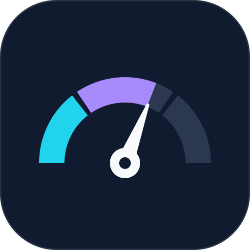

# Logo du projet



## Ce qu'il représente

Une **jauge sur 100**, l'unité de mesure du projet.

L'arc est découpé selon les pondérations réelles du score, dans l'ordre où elles
sont calculées :

| Segment | Pilier | Poids | Couleur |
|---|---|---|---|
| 1 | Cloud | 30 points | `#22D3EE` |
| 2 | IA | 40 points | `#A78BFA` |
| 3 | Données | 30 points | `#FBBF24` |

**L'aiguille est à 61,9 sur 100.** Ce n'est pas une valeur décorative : c'est le
score le plus élevé réellement observé dans les données INSEE 2023 (activités
spécialisées, scientifiques et techniques, 250 personnes ou plus). Tout ce qui
est au-delà est en gris `#2B3850` — personne ne s'y trouve.

Le logo dit donc la même chose que le README : **l'échelle n'est jamais
parcourue entièrement.** Atteindre 100 supposerait que toutes les entreprises
d'une ligne utilisent les trois technologies ; l'IA pèse 40 points pour 5,9 %
d'adoption nationale, ce qui plafonne mécaniquement l'ensemble.

C'est pourquoi le segment « Données » n'apparaît jamais en couleur : il commence
à 70 points, au-delà du maximum observé.

## Les fichiers

| Fichier | Usage |
|---|---|
| `logo-mark.svg` | La marque carrée seule. En-tête du README, avatar GitHub, favicon. Porte son propre fond, donc lisible sur n'importe quelle couleur. |
| `logo.svg` | Marque + nom, pour **fond clair**. |
| `logo-dark.svg` | Marque + nom, pour **fond sombre**. |
| `logo-mark-512.png` | Rendu matriciel 512 × 512, fond transparent hors de la plaque. Pour ce qui ne lit pas le SVG : Power BI, diapositives, favicon généré. |

## À savoir avant de s'en servir

- **La marque tient jusqu'à 24 px.** En dessous, l'aiguille se confond avec
  l'arc : à 16 px le logo ne reste qu'une tache bleu-violet. Pour un favicon,
  préférer 32 px.
- **Les deux fichiers avec le nom utilisent les polices du système**
  (`system-ui`, puis Segoe UI / Roboto / Helvetica). Le texte n'est pas vectorisé :
  le rendu varie légèrement d'une machine à l'autre. C'est sans conséquence dans
  un navigateur ; pour un tirage où la fidélité compte, vectoriser le texte.
- **Ne pas recolorer l'arc.** Les trois couleurs portent les trois piliers, et le
  gris porte le « reste à parcourir ». Les changer vide le logo de son sens.

## Le modifier

Les SVG ont été produits par un script de génération, mais ce sont **eux qui font
foi** : ils sont versionnés et se modifient directement, le script n'est pas
conservé. La géométrie tient en quatre valeurs, lisibles dans le fichier :
centre `(256, 334)`, rayon de l'axe `150`, épaisseur de l'arc `52`, et un arc de
180° parcouru de la gauche (`180°`) vers la droite (`0°`). L'aiguille est à
`68,58°`, soit 61,9 % de l'arc.

Le PNG a été rendu depuis le SVG avec Chrome sans interface :

```bash
chrome --headless --disable-gpu --default-background-color=00000000 \
       --screenshot=logo-mark-512.png --window-size=512,512 page.html
```
